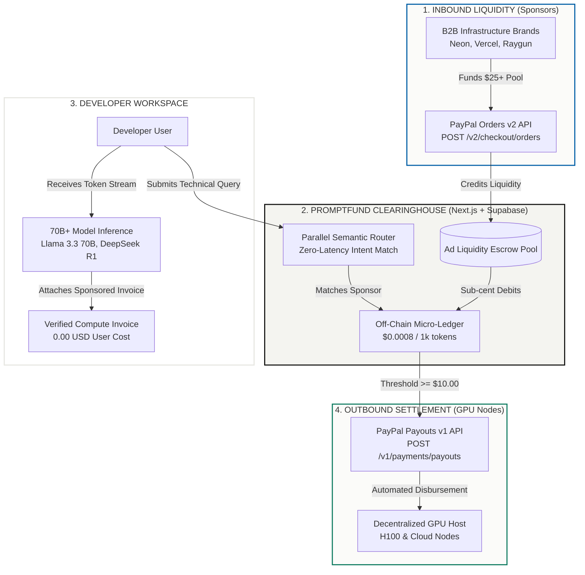

# PromptFund AI ⚡

> **Autonomous Ad-Funded Open Compute Clearinghouse Powered by PayPal**  
> *Submitted to the PayPal AI Hackathon: Build What's Next with PayPal and AI*

[](https://developer.paypal.com)
[](https://nextjs.org)
[](https://vercel.com)
[](LICENSE)
[](https://paypalaihackathon.devpost.com)

---

## 💡 The 30-Second Summary

Running 70B+ open models (Llama 3.3 70B, DeepSeek R1) costs a fortune in GPU compute. Developers face \$20/month subscription paywalls, while charging \$0.004 per prompt over credit cards is impossible due to fixed interchange fees (30¢ + 2.9%).

**PromptFund AI** solves this with an **autonomous 3-sided compute clearinghouse**:
1. **Sponsors** fund compute pools via **PayPal Orders v2 API** targeting high-intent developer keywords.
2. **Developers** prompt 70B+ models for free and receive clean, verified **Compute Invoices** covered by sponsors.
3. **GPU Nodes** earn automated hardware disbursements via **PayPal Payouts v1 API** once pending earnings cross the \$10.00 threshold.

---

## 🏗️ System Architecture & Financial Flow



---

## 🛠️ PayPal Developer Platform Integration

| PayPal Rail | API Endpoint | Implementation & Purpose |
| :--- | :--- | :--- |
| **Inbound Liquidity** | `POST /v2/checkout/orders` | Sponsors deposit \$25, \$50, or \$100 into the compute pool via PayPal Sandbox Orders v2. |
| **Capture Order** | `POST /v2/checkout/orders/{id}/capture` | Captures authorized funds and atomically increments the sponsor's liquidity reserve. |
| **Outbound Settlement** | `POST /v1/payments/payouts` | Disburses accumulated earnings to the GPU operator's PayPal business account (`sb-smwfk53876648@business.example.com`). |
| **Off-Chain Micro-Ledger** | Next.js Serverless + Supabase | Processes sub-cent token accounting (\$0.0008/1k tokens) without payment interchange fee erosion. |

---

## 💻 Tech Stack & System Components

* **Frontend Framework:** Next.js 14 (App Router, Server Actions, TypeScript)
* **Styling & UI:** Tailwind CSS, Lucide Icons, Swiss Editorial & Fintech Daylight Palette
* **Payment Rails:** PayPal Developer Platform (Orders v2 API & Payouts v1 API)
* **AI Model Engine:** Groq SDK / OpenAI-compatible endpoint (Llama 3.3 70B, DeepSeek R1, Mixtral 8x7B)
* **Micro-Accounting State:** Supabase PostgreSQL with atomic stored procedures + in-memory fallback store
* **Deployment Target:** Vercel Edge & Serverless Node.js Runtime

---

## 🚀 Live Product Experience

* **Landing Page Overview:** Minimalist, high-contrast overview explaining the circular compute economy.
* **Persistent 2-Column Workbench:** Left 60% AI workspace with model switcher; Right 40% real-time financial clearinghouse.
* **Embedded Model Selector:** Real-time switching between **Llama 3.3 70B**, **DeepSeek R1**, and **Mixtral 8x7B** inside the chat canvas.
* **Responsive Multi-Device Layout:** Full desktop split-view, with an automated tab switcher for tablets and mobile devices.

---

## ⚡ Quick Start Guide (Under 1 Minute)

### 1. Clone & Install Dependencies
```bash
git clone https://github.com/luxmikant/Promptfund.git
cd Promptfund
npm install
```

### 2. Configure Environment Variables
Copy `.env.example` to `.env.local`:
```bash
cp .env.example .env.local
```

Fill in your PayPal Sandbox credentials:
```env
PAYPAL_CLIENT_ID=your_sandbox_client_id
PAYPAL_CLIENT_SECRET=your_sandbox_secret
PAYPAL_API_BASE=https://api-m.sandbox.paypal.com
NEXT_PUBLIC_PAYPAL_CLIENT_ID=your_sandbox_client_id
PAYPAL_BUSINESS_EMAIL=your_sandbox_business_email@business.example.com
```

### 3. Run Development Server
```bash
npm run dev
```
Open **`http://localhost:3000`** in your browser.

---

## 📂 Project Structure

```
Promptfund/
├── src/
│   ├── app/
│   │   ├── api/
│   │   │   ├── chat/route.ts              # Parallel semantic matcher & token stream
│   │   │   ├── payouts/route.ts           # PayPal Payouts v1 batch settlement
│   │   │   ├── sponsor/create-order/      # PayPal Orders v2 order creation
│   │   │   ├── sponsor/capture-order/     # PayPal Orders v2 capture & escrow credit
│   │   │   └── telemetry/route.ts         # Real-time clearinghouse state
│   │   ├── globals.css                    # Swiss Editorial & Fintech Daylight theme
│   │   ├── layout.tsx                     # Root layout with Inter & JetBrains Mono
│   │   └── page.tsx                       # Responsive workbench & landing coordinator
│   ├── components/
│   │   ├── LandingPage.tsx                # Product landing page & architecture diagram
│   │   ├── HeaderBar.tsx                  # 56px minimalist top bar & view switcher
│   │   ├── ChatWorkspace.tsx              # Model selector card & verified invoice receipts
│   │   └── ClearinghouseDashboard.tsx     # Persistent 2-column PayPal ledger dashboard
│   └── lib/
│       ├── ad-matcher.ts                  # Semantic intent matching engine
│       ├── paypal.ts                      # PayPal REST API SDK client
│       ├── store.ts                       # Ledger state with in-memory fallback
│       └── types.ts                       # TypeScript data contracts
├── supabase/
│   └── migrations/001_initial_schema.sql  # Supabase PostgreSQL ledger schema
├── vercel.json                            # Vercel serverless configuration
├── LICENSE                                # MIT Open Source License
└── README.md                              # This specification document
```

---

## 📄 License

This project is open-source under the [MIT License](LICENSE) — built for the PayPal AI Hackathon 2026.
